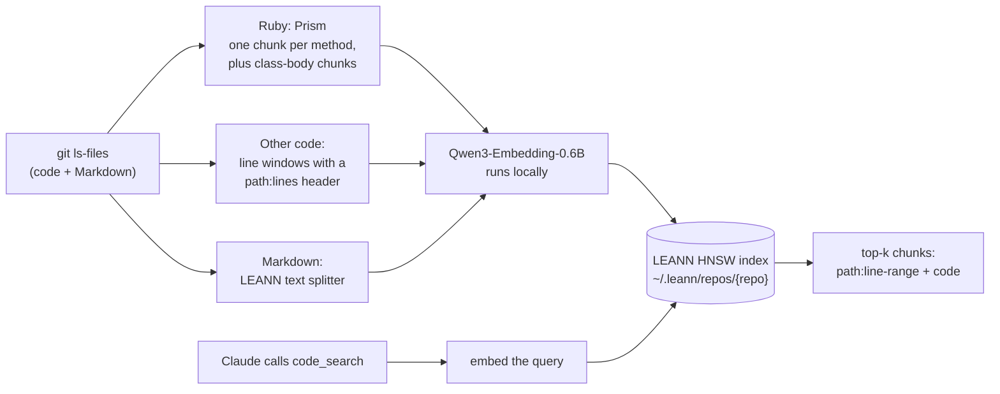

# code-search

Semantic code search for Claude Code. It finds code by what the code does, not by what it is called. Everything runs on your machine.

## Why

grep and LSP are fast and exact when you know a name. When you only know the behavior ("where do we retry a failed webhook?"), Claude has to guess names and search many times. code-search gives Claude one more tool, `code_search`, that ranks chunks of your repo by meaning. It does not replace grep or LSP. The tool description tells Claude to keep using them for exact symbols.

## How it works



The index skips `spec`, `test`, `tests`, `__tests__`, `__mocks__`, `vendor`, `node_modules`, `dist`, `fixtures` and `coverage` directories, `db/migrate/`, `*.test.*`, `*.spec.*` and `*.stories.*` files, minified JS, symlinks, and files over 256 KB.

## Requirements

- macOS on Apple Silicon is recommended. The embedding model runs on the GPU. Other platforms are untested, and a CPU-only build is much slower.
- [uv](https://docs.astral.sh/uv/getting-started/installation/). It installs Python 3.12 for you if you do not have it.
- The [Claude Code CLI](https://code.claude.com/docs/en/setup) (`claude`).
- git.
- Optional: Ruby 3.3 or later, for Prism chunking of Ruby files. Without it, Ruby files get line-window chunks, which search less well. The tool looks for a Ruby with Prism in this order: `CODE_SEARCH_RUBY`, `ruby` on your PATH, then asdf, rbenv and mise installs (newest first), then Homebrew. Your repo can pin an older Ruby. The tool finds a newer one on its own.

## Install

```bash
git clone <repo-url> ~/code-search
cd ~/code-search
./install.sh
```

`install.sh` is safe to run again. It:

1. checks for `git`, `uv` and `claude`
2. runs `uv sync --locked` to create `.venv`
3. registers the MCP server at user scope: `claude mcp add --scope user code-search -- <checkout>/.venv/bin/python <checkout>/code_search.py serve`. If a `code-search` server is already registered, it tells you and changes nothing.
4. reports which Ruby with Prism it found, if any
5. prints the permission rules and the first-index command below

Restart any open Claude Code sessions so they load the server.

To skip the permission prompt each time Claude searches, add these two rules to `permissions.allow` in `~/.claude/settings.json`. The installer does not edit your settings.

```json
"mcp__code-search__code_search",
"mcp__code-search__code_index"
```

## Uninstall

```bash
./uninstall.sh
```

It removes the MCP registration (only if it points at this checkout) and `.venv`. It does not delete your indexes or the downloaded model. It prints the commands to delete them.

## Usage

### Build an index

Each repo needs an index once. From a Claude Code session in the repo, ask Claude to "build the code_search index". It calls `code_index`, which builds in the background. Or run it yourself:

```bash
~/code-search/.venv/bin/python ~/code-search/code_search.py index --repo /path/to/repo
```

The first build downloads the embedding model. The build log is at `~/.leann/repos/<repo>/build.log`.

### Search

Claude calls `code_search` on its own when it needs to find code by meaning. You can also ask for it: "use code_search to find where we send the weekly digest email". The tool takes:

| Argument | Meaning |
|---|---|
| `query` | What the code does, in plain words. |
| `top_k` | Number of chunks to return. Default 8. |
| `path_prefix` | Only return files under this repo-relative path, for example `app/models/`. |
| `repo_path` | Any path in the repo. Default: the session's working directory. |

Each result is a repo-relative path, a line range, the method or class name when there is one, and the code.

From the shell:

```bash
~/code-search/.venv/bin/python ~/code-search/code_search.py search "where do we retry a failed webhook" --repo /path/to/repo
```

### Worktrees share one index

The index belongs to the repo's main checkout. Every git worktree of that repo searches the same index, so you build once per repo, not once per worktree.

A build always reads the main checkout's files, not the worktree's. The first line of every result says how many commits your checkout has that the index does not. Paths are repo-relative, so open them in your own checkout.

### Auto-refresh

- When you search an index that is 24 hours old or older, a rebuild starts in the background. Search keeps using the old index until the new one is ready. Then the new index replaces it in one step.
- Only one build per repo runs at a time.
- If a refresh failed in the last 24 hours, search does not start another one. It tells Claude to call `code_index`, which retries on demand.
- Call `code_index` yourself after a large merge if you do not want to wait.
- The last 2 builds are kept on disk. Older ones are deleted.

### Configuration

The built-in defaults are the setup that won the benchmarks below, so you need no config file. To change something, copy `config.example.json` to `config.json` and keep only the keys you change. `config.example.json` documents each key. A change takes effect at the next build.

Environment variables (set them for the MCP server with `claude mcp add -e NAME=value ...`):

| Variable | Default | Meaning |
|---|---|---|
| `CODE_SEARCH_HOME` | `~/.leann/repos` | Where indexes live. |
| `CODE_SEARCH_USAGE_LOG` | `~/.leann/usage.jsonl` | Local usage log. Set it to `/dev/null` to turn it off. |
| `CODE_SEARCH_RUBY` | (search) | A Ruby 3.3+ binary to use for Prism. |

## Costs

- **First build.** Build time grows with the number of chunks. A large repo (about 15k files, 60k chunks) takes about 27 min on an Apple Silicon GPU. A tiny repo takes under a minute, most of it loading the model. Each auto-refresh is a full rebuild in the background, with the same build time.
- **Model download.** About 1.2 GB, once, into the Hugging Face cache.
- **Memory.** Each Claude Code session starts its own search server. After its first search, a server uses about 3 GB of RAM for the model and the index. A server that has not searched yet uses little memory. A background build loads the model again while it runs.
- **Disk.** An index of a large repo is about 400 MB. With 2 builds kept, plan for about 800 MB per large repo.
- **First search in a session.** It loads the model and the index, so it takes a few seconds (median 4.2 s in the benchmark). Later searches are fast.

## Privacy

- Indexing and search run on your machine. No code is sent anywhere to build or search an index.
- The only download is the embedding model, from Hugging Face, on the first build. When the model loads, the Hugging Face client can check huggingface.co for model updates. It does not send your code or queries. To stop all network access after the first download, set `HF_HUB_OFFLINE=1` for the server.
- Search results go to Claude, the same as the output of a Read or grep.
- The usage log records one line per search: time, repo, latency, whether it was the session's first search, `top_k`, result count, index age and model. It never records the query text. It stays on your machine.

## Benchmark results

On 35 find-the-file questions in a large Rails and TypeScript monorepo, headless Claude Code ran each question once without code_search and once with it. Same model, prompt and built-in tools.

| | Without code_search | With code_search |
|---|---|---|
| Median tokens per question | 102k | 88k (14% fewer) |
| Median time per question | 13.6 s | 12.7 s |
| Right file in the top 3 answers | 34 of 35 | 34 of 35 |
| Right file as the first answer | 34 of 35 | 33 of 35 |

- Claude chose to call the tool on 19 of the 35 questions. On those, it saved a median of about 22k tokens per question. On the other 16, the median run used about 1.8k more tokens.
- The gain is not even across questions. Compared question by question, the median difference is close to zero. The savings come from the questions where Claude used the tool.
- Each question ran once per condition, so treat small differences as noise.
- Search quality alone, without Claude: with this setup, the right file was in the top 5 results for 17 of 20 questions. With stock LEANN chunking, it was 4 of 20.
- Results for a set of harder questions are in progress.

## Run the benchmark on your own repo

### 1. Write questions

Copy `eval/example.json` to a new file in `eval/`, for example `eval/myrepo.json`. Files in `eval/` other than the example are gitignored, so your questions stay local.

```json
{
  "repo": "your-org/your-repo",
  "frozen_on": "2026-01-31",
  "notes": "Free text.",
  "questions": [
    {"lang": "rb", "kind": "concept", "q": "Where do we retry a failed outgoing webhook delivery?", "expect": ["app/workers/webhook_delivery_worker.rb"]}
  ]
}
```

| Field | Required | Meaning |
|---|---|---|
| `questions[].q` | yes | The question, in the words a teammate would use. |
| `questions[].expect` | yes | Repo-relative paths. An answer is right if it names any of them. |
| `questions[].lang` | no | A label such as `rb` or `ts`. Results are also grouped by it. |
| `questions[].kind` | no | Another label, for example `vocab`, `concept` or `flow`. The end-to-end harness groups by it. |
| `repo`, `frozen_on`, `notes` | no | For you. The tools ignore them. |

Check each answer by hand, then do not change the file. Changing questions between runs makes the runs incomparable.

### 2. Score search quality (free, no Claude)

Build a named comparison index and score it. Comparison indexes do not affect the index that search uses.

```bash
cd ~/code-search
.venv/bin/python code_search.py variant base --repo /path/to/repo
.venv/bin/python code_search.py eval base eval/myrepo.json --repo /path/to/repo
```

`eval` prints the rank of the right file for each question, then hit@1, hit@5, hit@10 and MRR. `variant` takes flags to compare chunkers and models: `--ruby`, `--other`, `--model`, `--mode`, `--ruby-max-chars` and `--query-prompt`.

### 3. Measure Claude end to end (bills your Claude account)

Each run is a real `claude -p` session, capped at $1. `--budget` caps the total spend of a run (default $40). Build the repo's index first.

```bash
cd ~/code-search
# smoke test: 3 questions, no history row
.venv/bin/python bench/run_bench.py run --repo /path/to/repo --questions eval/myrepo.json --limit 3 --no-history
# full run
.venv/bin/python bench/run_bench.py run --repo /path/to/repo --questions eval/myrepo.json
```

Results go to `bench/runs/<timestamp>/` (`summary.json`, plus the full stream of every session), and one row per run goes to `bench/history.jsonl`. Both are gitignored. `bench/run_bench.py --help` lists the conditions and options, including `baseline_hooks`, which prices your own Claude Code hooks.

## Troubleshooting

- **"No code-search index for ..."**: build one (see Usage).
- **Claude does not see the tool**: restart the session, then run `claude mcp get code-search`. It should show `Status: Connected`.
- **Ruby files are not chunked by method**: the build log says "no Ruby with Prism". Install Ruby 3.3+ and run `./install.sh` again to see if it is found. Or point the server at one: `claude mcp remove code-search -s user`, then `claude mcp add --scope user -e CODE_SEARCH_RUBY=/path/to/ruby code-search -- <checkout>/.venv/bin/python <checkout>/code_search.py serve`. Then call `code_index`.
- **A build failed**: read `~/.leann/repos/<repo>/build.log`. Fix the cause, then call `code_index`.
- **Results look old**: the index is built from the main checkout. Check the "commits the index lacks" count in the first line of the results, and call `code_index` to rebuild.
- **High memory use**: each session with a search server uses about 3 GB after its first search. Close idle sessions.

## Credits

- [LEANN](https://github.com/StarTrail-org/LEANN): vector index and search (MIT).
- [Prism](https://github.com/ruby/prism): Ruby parser, in Ruby 3.3+ (MIT).
- [Qwen3-Embedding-0.6B](https://huggingface.co/Qwen/Qwen3-Embedding-0.6B): embedding model (Apache 2.0).

License: TBD
