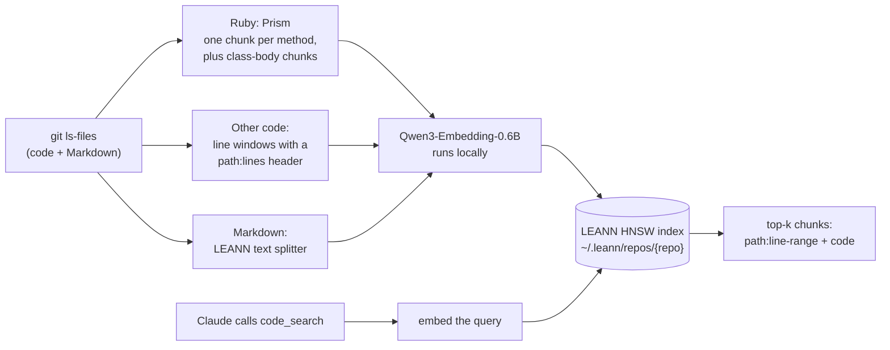

# code-search

Semantic code search for Claude Code. It finds code by what the code does, not by what it is called. Everything runs on your machine.

code-search is a code-search layer built on [LEANN](https://github.com/StarTrail-org/LEANN) ([paper](https://arxiv.org/abs/2506.08276)). LEANN supplies the vector index, the builder and searcher API, and the pattern for serving search to Claude Code over MCP. This project adds code-aware chunking, a code-tuned embedding setup, one shared index per repo, auto-refresh and a benchmark harness.

## Why use it

- **It finds code by meaning.** Ask "where do we retry a failed webhook?" without knowing a class or method name.
- **Fewer turns when Claude uses it.** In our benchmark, Claude called it in 19 of 35 sessions. On those 19 questions, sessions averaged about one fewer turn than without it (5.4 to 4.3), and the median cached context they re-read fell from 83k to 59k tokens. Across all 35 questions, median tokens fell 14%.
- **It is local and private.** No code leaves your machine.
- **One index per repo.** Every worktree of the repo uses it, and it rebuilds itself in the background when it is a day old.
- **It is fast once warm.** One search server, shared by every session, keeps the model loaded. While it runs, a search from any session takes about 0.1 s, including a new session's first search.

## When to use it, and when not

| Kind of question | Best tool |
|---|---|
| Where is X handled? How does Y work? | `code_search` |
| Product words that differ from code names (the UI says "workspace", the code says `organization`) | `code_search` |
| Unfamiliar or large repo, onboarding | `code_search` |
| Exact symbol: definition, references, callers | LSP |
| Literal strings: error messages, config keys, log lines | `rg` or `grep` |
| You already know the file | Read |

Skip it when:

- **The repo is small.** grep is already fast.
- **You have no Apple Silicon GPU.** The first build is slow on a CPU.
- **RAM is tight.** The shared search server uses about 2.4 GB with the model and one large index loaded. It exits after 2 hours without a search.
- **grep answers the question in one call.** Our question set was easy for grep. Per question, the median saving was about zero. On the 16 questions where Claude did not call the tool, the median session used about 1.8k more tokens.

## How it works



The index skips `spec`, `test`, `tests`, `__tests__`, `__mocks__`, `vendor`, `node_modules`, `dist`, `fixtures` and `coverage` directories, `db/migrate/`, `*.test.*`, `*.spec.*` and `*.stories.*` files, minified JS, symlinks, and files over 256 KB.

## Requirements

- macOS on Apple Silicon is recommended. The embedding model runs on the GPU. Other platforms are untested, and a CPU-only build is much slower.
- [uv](https://docs.astral.sh/uv/getting-started/installation/). It installs Python 3.12 for you if you do not have it.
- The [Claude Code CLI](https://code.claude.com/docs/en/setup) (`claude`).
- git.
- Optional: Ruby 3.3 or later, for Prism chunking of Ruby files. Newer is better. On our test repo, Prism 1.9 (Ruby 4.0) parsed every indexed Ruby file with no errors, and Ruby 3.3's Prism 0.19 reported errors on 9 of them.
  - The tool uses the first Ruby with Prism that it finds, in this order: `CODE_SEARCH_RUBY`, `ruby` on your PATH (with a version manager, that is the repo's pinned Ruby), asdf, rbenv and mise installs (newest first), then Homebrew.
  - A pinned Ruby older than 3.3 has no Prism, so the tool skips it.
  - Without any Ruby 3.3+, Ruby files get line-window chunks, which search less well.

## Install

```bash
git clone https://github.com/rjrobinson/code-search.git ~/code-search
cd ~/code-search
./install.sh
```

`install.sh` is safe to run again. It:

1. checks for `git`, `uv` and `claude`
2. runs `uv sync --locked` to create `.venv`
3. registers the MCP server at user scope: `claude mcp add --scope user code-search -- <checkout>/.venv/bin/python <checkout>/code_search.py serve`. If a `code-search` server is already registered, it tells you and changes nothing.
4. reports which Ruby with Prism it found, if any
5. prints the permission rules and the first-index command below

Restart any open Claude Code sessions so they load the server.

To skip the permission prompt each time Claude searches, add these two rules to `permissions.allow` in `~/.claude/settings.json`. The installer does not edit your settings.

```json
"mcp__code-search__code_search",
"mcp__code-search__code_index"
```

## Uninstall

```bash
./uninstall.sh
```

It removes the MCP registration (only if it points at this checkout) and `.venv`. It does not delete your indexes or the downloaded model. It prints the commands to delete them.

It does not stop a search server that is running. The server exits by itself after 2 hours without a search. To stop it now, run `code_search.py status` and kill the `pid` it shows. If you installed the launchd agent below, unload it first.

## Usage

### Build an index

Each repo needs an index once. From a Claude Code session in the repo, ask Claude to "build the code_search index". It calls `code_index`, which builds in the background. Or run it yourself:

```bash
~/code-search/.venv/bin/python ~/code-search/code_search.py index --repo /path/to/repo
```

The first build downloads the embedding model. The build log is at `~/.leann/repos/<repo>/build.log`.

### Search

Claude calls `code_search` on its own when it needs to find code by meaning. You can also ask for it: "use code_search to find where we resize uploaded images". The tool takes:

| Argument | Meaning |
|---|---|
| `query` | What the code does, in plain words. |
| `top_k` | Number of chunks to return. Default 8. |
| `path_prefix` | Only return files under this repo-relative path, for example `app/models/`. |
| `repo_path` | Any path in the repo. Default: the session's working directory. |

Each result is a repo-relative path, a line range, the method or class name when there is one, and the code.

From the shell:

```bash
~/code-search/.venv/bin/python ~/code-search/code_search.py search "where do we retry a failed webhook" --repo /path/to/repo
```

### Worktrees share one index

The index belongs to the repo's main checkout. Every git worktree of that repo searches the same index, so you build once per repo, not once per worktree.

A build always reads the main checkout's files, not the worktree's. The first line of every result says how many commits your checkout has that the index does not. Paths are repo-relative, so open them in your own checkout.

### Auto-refresh

- When you search an index that is 24 hours old or older, a rebuild starts in the background. Search keeps using the old index until the new one is ready. Then the new index replaces it in one step.
- Only one build per repo runs at a time.
- If a refresh failed in the last 24 hours, search does not start another one. It tells Claude to call `code_index`, which retries on demand.
- Call `code_index` yourself after a large merge if you do not want to wait.
- The last 2 builds are kept on disk. Older ones are deleted.

### The search server

Every Claude Code session starts its own MCP server, but that server does not load the model. It sends each search to one shared search server (`code_search.py daemon`), which holds the model and recently used indexes for all sessions.

- **Start.** The first search that finds no server starts one in the background, then waits for it. That search takes a few seconds. Searches after it, from any session, take about 0.1 s.
- **Indexes.** The server keeps up to 4 indexes loaded, one per repo, and drops the least recently used. When a rebuild replaces an index, the next search loads the new one. No restart is needed.
- **Stop.** The server exits after 2 hours without a search (`CODE_SEARCH_DAEMON_IDLE`). The next search starts it again.
- **Fallback.** If the server cannot start or fails, the session searches in its own process, as before, and tries the server again after 5 minutes. Search keeps working either way. Set `CODE_SEARCH_DAEMON=0` to always search in-process.
- **Socket.** The server listens on a Unix socket at `~/.leann/code-search.sock`, readable only by you (mode 0600). Only one server runs at a time.
- **Logs and status.** The log is `~/.leann/daemon.log`. To see the server's PID, uptime, memory, loaded indexes and search count:

  ```bash
  ~/code-search/.venv/bin/python ~/code-search/code_search.py status
  ```

- The shell `search` command uses the same server.
- The server takes its environment from the session that started it. Set the environment variables below the same way for every session.

#### Optional: keep the server warm all the time

To skip even the first slow search, start the server at login with launchd. The installer does not do this. Save the file below as `~/Library/LaunchAgents/local.code-search.daemon.plist`. Replace `/Users/you/code-search` with your checkout and `/Users/you` with your home directory, because launchd does not expand `~`.

```xml
<?xml version="1.0" encoding="UTF-8"?>
<!DOCTYPE plist PUBLIC "-//Apple//DTD PLIST 1.0//EN" "http://www.apple.com/DTDs/PropertyList-1.0.dtd">
<plist version="1.0">
<dict>
  <key>Label</key><string>local.code-search.daemon</string>
  <key>ProgramArguments</key>
  <array>
    <string>/Users/you/code-search/.venv/bin/python</string>
    <string>/Users/you/code-search/code_search.py</string>
    <string>daemon</string>
  </array>
  <key>EnvironmentVariables</key>
  <dict>
    <key>CODE_SEARCH_DAEMON_IDLE</key><string>0</string>
  </dict>
  <key>RunAtLoad</key><true/>
  <key>KeepAlive</key>
  <dict>
    <key>SuccessfulExit</key><false/>
  </dict>
  <key>StandardOutPath</key><string>/Users/you/.leann/daemon.log</string>
  <key>StandardErrorPath</key><string>/Users/you/.leann/daemon.log</string>
</dict>
</plist>
```

- `CODE_SEARCH_DAEMON_IDLE=0` turns off the idle exit.
- `KeepAlive` with `SuccessfulExit` false restarts the server after a crash. It does not restart it after a clean exit, for example when another server already runs.
- The memory stays in use all day: about 2.2 GB with the model alone, and about 2.4 GB with one large index loaded.
- Load it with `launchctl load ~/Library/LaunchAgents/local.code-search.daemon.plist`. Unload it with `launchctl unload` and the same path.

### Configuration

The built-in defaults are the setup that won the benchmarks below, so you need no config file. To change something, copy `config.example.json` to `config.json` and keep only the keys you change. `config.example.json` documents each key. A change takes effect at the next build.

Environment variables (set them for the MCP server with `claude mcp add -e NAME=value ...`):

| Variable | Default | Meaning |
|---|---|---|
| `CODE_SEARCH_HOME` | `~/.leann/repos` | Where indexes live. |
| `CODE_SEARCH_USAGE_LOG` | `~/.leann/usage.jsonl` | Local usage log. Set it to `/dev/null` to turn it off. |
| `CODE_SEARCH_RUBY` | (search) | A Ruby 3.3+ binary to use for Prism. |
| `CODE_SEARCH_DAEMON` | `1` | `0` turns off the shared search server. Each session then searches in its own process. |
| `CODE_SEARCH_DAEMON_IDLE` | `7200` | Seconds without a search before the server exits. `0` means never. |
| `CODE_SEARCH_SOCKET` | `~/.leann/code-search.sock` | The server's socket. The server's lock and log go in the same directory. The path must be 103 bytes or shorter. |

## Costs

- **First build.** Build time grows with the number of chunks. A large repo (about 15k files, 60k chunks) takes about 27 min on an Apple Silicon GPU. A tiny repo takes under a minute, most of it loading the model. Each auto-refresh is a full rebuild in the background, with the same build time.
- **Model download.** About 1.2 GB, once, into the Hugging Face cache.
- **Memory.** One shared search server holds the model for every session. Its macOS memory footprint, which counts GPU memory, is about 2.2 GB with the model alone. A large index adds about 250 MB, and the server keeps up to 4 indexes. Each session's own MCP server uses about 15 MB. A background build loads the model again while it runs. With `CODE_SEARCH_DAEMON=0`, each session that searches holds its own copy, about 2.4 GB.
- **Disk.** An index of a large repo is about 400 MB. With 2 builds kept, plan for about 800 MB per large repo.
- **First search.** Only the search that starts the server is slow, because it loads the model and the index: about 4 s for a tiny repo and 6 to 7 s for a large one. After that, a search from any session takes about 0.1 s, including a new session's first search, until the server exits after 2 idle hours.

## Privacy

- Indexing and search run on your machine. No code is sent anywhere to build or search an index.
- The only download is the embedding model, from Hugging Face, on the first build. When the model loads, the Hugging Face client can check huggingface.co for model updates. It does not send your code or queries. To stop all network access after the first download, set `HF_HUB_OFFLINE=1` for the server.
- Search results go to Claude, the same as the output of a Read or grep.
- The usage log records one line per search: time, repo, latency, whether the search had to start the search server (or, in-process, load the model), whether it ran in the server or in-process, `top_k`, result count, index age and model. It never records the query text. It stays on your machine.
- The search server's log records the repo name, result count and time of each search. It never records the query text.

## Why this combination

| Piece | Why | Evidence |
|---|---|---|
| [LEANN](https://github.com/StarTrail-org/LEANN) | Local, small and MIT. Its builder and searcher API takes our own chunks and metadata, so the chunking is ours and the index is LEANN's. | The index of the test repo is about 400 MB. |
| [Prism](https://github.com/ruby/prism) for Ruby | Ruby's own parser. It gives one chunk per method, plus class-body chunks for Rails DSL calls (scopes, associations, callbacks). Each chunk starts with a header that holds the path, the line range and the qualified name, for example `# app/models/invoice.rb:6-9 Invoice#total_cents`. | Prism 1.9 parsed every indexed Ruby file in the test repo (about 6k) with 0 errors. Right file in the top 5, of 20 questions: stock text chunks 4, tree-sitter Ruby AST 7, Prism 12. |
| Line windows with a `path:lines` header, for TypeScript, JavaScript and other code | LEANN 0.3.8's stock code splitter puts a line number in front of every line, so the embedding sees many number tokens. Line windows keep the code as written and put the path and line range in one header line. | Measured together with the Qwen3 step below, not on its own. |
| [Qwen3-Embedding-0.6B](https://huggingface.co/Qwen/Qwen3-Embedding-0.6B) through sentence-transformers, with a query instruction | A small embedding model that handles code and takes an instruction for queries. | Against contriever with Prism, the right file in the top 5 went from 12 to 17 of 20, TypeScript from 0 to 4 of 5, and MRR from 0.304 to 0.655. This step also switched non-Ruby code to line windows, so the gain belongs to the combination. |
| Stored embeddings, recompute off | LEANN can save disk by computing embeddings again at search time. We store them instead. Search then needs no embedding server and opens no port, so many sessions can search at once. | About 0.1 s per search after the model loads. The cost is disk, about 400 MB for a large repo, which is fine at repo scale. |

Two details about the model:

- **Why not MLX.** LEANN 0.3.8's MLX path runs a language model and mean-pools its output over padded tokens with no attention mask. sentence-transformers applies the pooling the model was trained with.
- **Why a 512-token cap.** Most chunks are 1,500 characters or less, but one very long line (minified or generated code) makes a much larger chunk. LEANN sets no token limit, and Qwen3 accepts up to 32k tokens. A build batch that holds such a chunk pads to that length and runs out of memory. The cap cuts those chunks to 512 tokens instead.

**Tested and not used:** hybrid search with BM25 (vector weight 0.7). Its rankings looked dominated by the BM25 scores, so we did not trust them. Search uses vector scores only (weight 1.0).

## Benchmarks

The test repo is a large private Rails + TypeScript monorepo (about 15k files, 60k chunks).

### Search quality

20 frozen find-the-file questions: 15 about Ruby code, 5 about TypeScript. A hit is the right file in the top 5 results.

| Setup | Right file in top 5 (of 20) | TypeScript (of 5) | MRR |
|---|---|---|---|
| Stock LEANN text chunks | 4 | 1 | 0.094 |
| tree-sitter Ruby AST chunks | 7 | 0 | 0.191 |
| Prism for Ruby, contriever | 12 | 0 | 0.304 |
| Prism for Ruby, line windows for other code, Qwen3 with a query instruction (the default) | 17 | 4 | 0.655 |

### Claude Code end to end

35 find-the-file questions. Headless Claude Code (`claude -p`) answered each question once without code_search and once with it. Both sessions had the same model, prompt and built-in tools. Other MCP servers, subagents and hooks were off.

| | Without code_search | With code_search |
|---|---|---|
| Median tokens per question | 102,051 | 87,652 (14% fewer) |
| Median time per question | 13.6 s | 12.7 s |
| Right file in the top 3 answers | 34 of 35 | 34 of 35 |
| Right file as the first answer | 34 of 35 | 33 of 35 |

- Claude called the tool in 19 of 35 sessions. On those questions, it saved a median of about 22k tokens.
- **These questions were easy for grep.** Without the tool, Claude found the right file for 34 of 35. Per question, the median saving was about zero. The 16 sessions that did not call the tool used a median of about 1.8k more tokens.
- Each question ran once per condition, so treat small differences as noise.
- These runs came before the shared search server. Each session loaded the model for its first search.
- **In progress:** a hard question set (vocabulary mismatch, concepts, multi-file flows).

## Run the benchmark on your own repo

### 1. Write questions

Copy `eval/example.json` to a new file in `eval/`, for example `eval/myrepo.json`. Files in `eval/` other than the example are gitignored, so your questions stay local.

```json
{
  "repo": "your-org/your-repo",
  "frozen_on": "2026-01-31",
  "notes": "Free text.",
  "questions": [
    {"lang": "rb", "kind": "concept", "q": "Where do we retry a failed outgoing webhook delivery?", "expect": ["app/workers/webhook_delivery_worker.rb"]}
  ]
}
```

| Field | Required | Meaning |
|---|---|---|
| `questions[].q` | yes | The question, in the words a teammate would use. |
| `questions[].expect` | yes | Repo-relative paths. An answer is right if it names any of them. |
| `questions[].lang` | no | A label such as `rb` or `ts`. Results are also grouped by it. |
| `questions[].kind` | no | Another label, for example `vocab`, `concept` or `flow`. The end-to-end harness groups by it. |
| `repo`, `frozen_on`, `notes` | no | For you. The tools ignore them. |

Check each answer by hand, then do not change the file. Changing questions between runs makes the runs incomparable.

### 2. Score search quality (free, no Claude)

Build a named comparison index and score it. Comparison indexes do not affect the index that search uses.

```bash
cd ~/code-search
.venv/bin/python code_search.py variant base --repo /path/to/repo
.venv/bin/python code_search.py eval base eval/myrepo.json --repo /path/to/repo
```

`eval` prints the rank of the right file for each question, then hit@1, hit@5, hit@10 and MRR. `variant` takes flags to compare chunkers and models: `--ruby`, `--other`, `--model`, `--mode`, `--ruby-max-chars` and `--query-prompt`.

### 3. Measure Claude end to end (bills your Claude account)

Each run is a real `claude -p` session, capped at $1. `--budget` caps the total spend of a run (default $40). Build the repo's index first.

```bash
cd ~/code-search
# smoke test: 3 questions, no history row
.venv/bin/python bench/run_bench.py run --repo /path/to/repo --questions eval/myrepo.json --limit 3 --no-history
# full run
.venv/bin/python bench/run_bench.py run --repo /path/to/repo --questions eval/myrepo.json
```

Results go to `bench/runs/<timestamp>/` (`summary.json`, plus the full stream of every session), and one row per run goes to `bench/history.jsonl`. Both are gitignored. `bench/run_bench.py --help` lists the conditions and options, including `baseline_hooks`, which prices your own Claude Code hooks.

## Note for LEANN users: tree-sitter 0.26.0

If you use LEANN's AST chunking, do not use tree-sitter 0.26.0. Its Python bindings have a memory bug that makes astchunk segfault on large files. [LEANN PR #453](https://github.com/StarTrail-org/LEANN/pull/453) (open) excludes that version. code-search does not need tree-sitter: its Ruby chunker is Prism, and its lock file has neither tree-sitter nor astchunk.

## Troubleshooting

- **"No code-search index for ..."**: build one (see Usage).
- **Claude does not see the tool**: restart the session, then run `claude mcp get code-search`. It should show `Status: Connected`.
- **Ruby files are not chunked by method**: the build log says "no Ruby with Prism". Install Ruby 3.3+ and run `./install.sh` again to see if it is found. Or point the server at one: `claude mcp remove code-search -s user`, then `claude mcp add --scope user -e CODE_SEARCH_RUBY=/path/to/ruby code-search -- <checkout>/.venv/bin/python <checkout>/code_search.py serve`. Then call `code_index`.
- **A build failed**: read `~/.leann/repos/<repo>/build.log`. Fix the cause, then call `code_index`.
- **Results look old**: the index is built from the main checkout. Check the "commits the index lacks" count in the first line of the results, and call `code_index` to rebuild.
- **High memory use**: run `code_search.py status`. One search server should hold the model, at about 2.2 GB plus about 250 MB per large index. If sessions still use about 2.4 GB each, they are searching in-process: their lines in `~/.leann/usage.jsonl` say `"via": "in-process"`. Check that `CODE_SEARCH_DAEMON` is not `0`, and read `~/.leann/daemon.log`. To free the memory now, kill the server's `pid`. The next search starts it again.
- **Every search is slow, or the first one fails over to in-process**: read `~/.leann/daemon.log`. After a failure, sessions search in-process for 5 minutes, then try the server again.

## Credits

- [LEANN](https://github.com/StarTrail-org/LEANN) ([paper](https://arxiv.org/abs/2506.08276)): the vector index, the builder and searcher API, and the MCP pattern this project follows (MIT).
- [Prism](https://github.com/ruby/prism): Ruby parser, in Ruby 3.3+ (MIT).
- [Qwen3-Embedding-0.6B](https://huggingface.co/Qwen/Qwen3-Embedding-0.6B): embedding model (Apache 2.0).
- [sentence-transformers](https://github.com/huggingface/sentence-transformers): runs the embedding model (Apache 2.0).

## License

[MIT](LICENSE)
